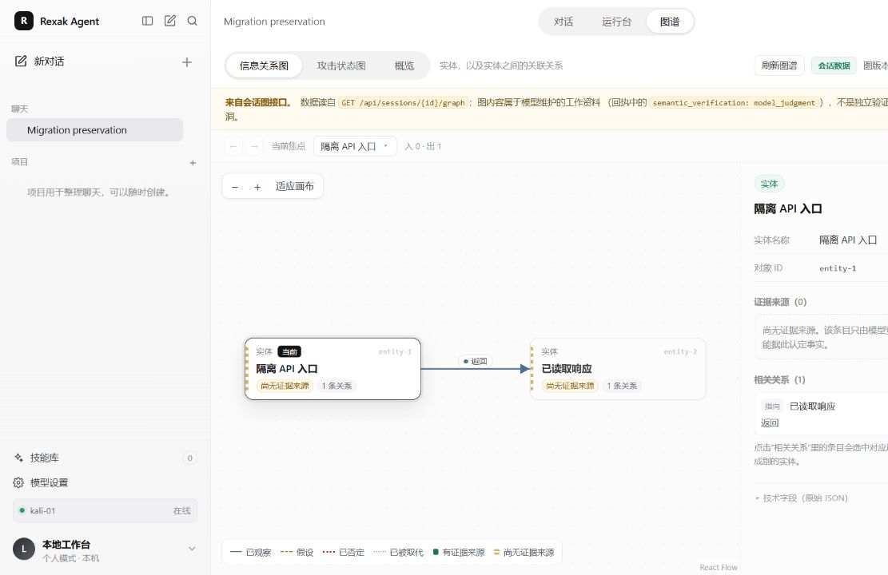
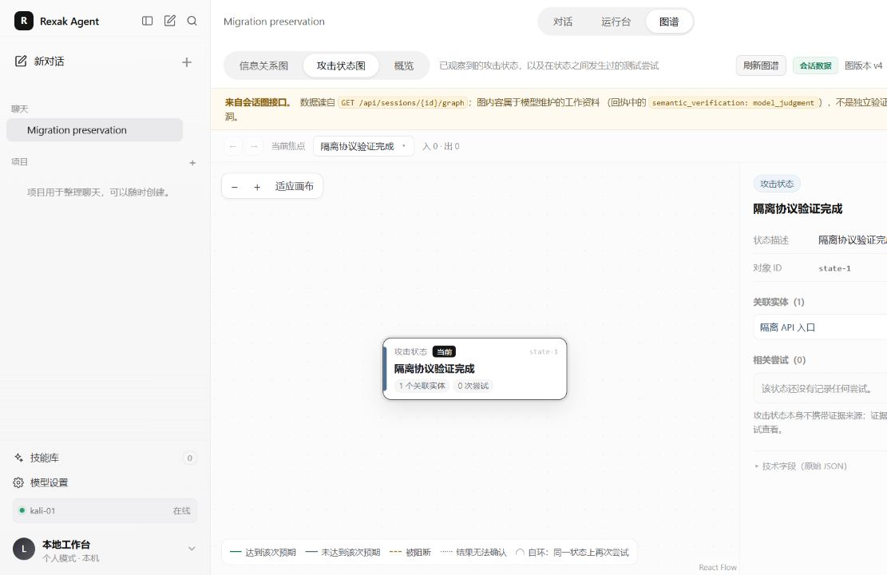
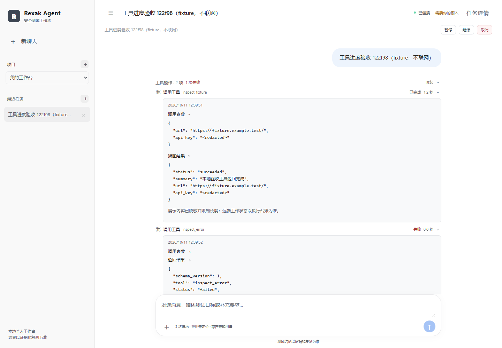
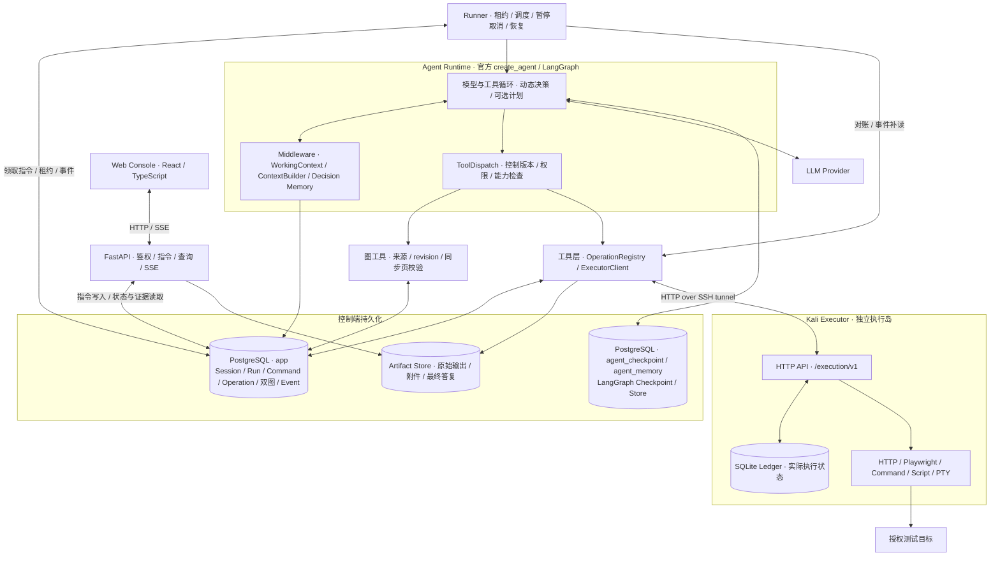

# rexak-agent

**LLM-Driven Autonomous Security Testing Agent**

面向授权 Web / API 安全测试与 CTF 场景的自主 Agent 工作台。用户给出目标与授权范围，Agent 组织测试步骤、调用远程工具，并根据回显调整行动、生成结果。项目将 LangChain / LangGraph 模型循环与独立 Runner、Kali 执行岛、持久化状态和证据链结合，使多步骤测试可观察、可恢复、可追溯。

[核心能力](#核心能力) · [系统架构](#系统架构) · [快速开始](#快速开始) · [验证与案例](#验证与案例) · [项目文档](#项目文档)

## 控制台预览

真实 React Web Console 集成对话、运行控制、工具记录与 Session 双图。下图来自 **2026-10-30 真实后端验收**，使用隔离数据库中的 **Demo 夹具**，展示信息关系和节点详情，不代表真实漏洞发现。



<details>
<summary>查看更多：攻击状态图与工具执行详情</summary>

**Attack State Graph｜攻击状态图**：同一隔离验收 Demo，手动刷新后读取到图版本 v4。



**工具执行详情**：2026-10-11 真实前端验收截图，使用不联网的 Demo 工具，展示参数、结果、失败状态及脱敏投影。此图为历史界面，当前布局已有调整。



截图均来自实际应用，无真实 API Key、Cookie、Token、靶场答案或私有目标地址。来源与验收范围见[公开验收摘要](docs/validation-v1.md)。

</details>

## 核心能力

### 自主测试执行｜Autonomous Execution

官方 `create_agent` 是唯一模型—工具循环，LangGraph 负责编排状态。Agent 结合目标、工具反馈和历史证据决定下一步，通过 `update_plan` 维护可选结构化计划；没有第二套独立 Planner 主循环。HTTP、浏览器、脚本及异步 Job 支持多阶段测试，普通模型答复自然结束，Runner 随后完成运行安全收尾。

`WorkingContext` 汇集当前领域记录，`ContextBuilder` 为每次请求组织上下文和完整输入预算。中间件在请求、派发与片段边界处理用户指令、控制版本、响应恢复和模型调用记录；原始消息与实际发送视图有各自来源，便于复盘模型当时获得了哪些信息。

### 远程工具与执行隔离｜Remote Execution

控制端与 Kali Executor 分离。HTTP 请求、Playwright 浏览器、命令、脚本和 PTY 终端在执行岛运行，控制端通过 **SSH 隧道上的 HTTP API** 派发，执行子协议为 `/execution/v1`。模型密钥与数据库凭据留在控制端。

工具调用经过参数、能力、Scope、Run 所有权及控制版本检查。耗时操作作为 Job 管理，支持输出游标、等待唤醒、取消和资源生命周期。命令/终端按 Executor 实际能力开放，可组合 Kali 已安装的安全测试工具；缺失能力明确报告，不回退到控制端执行。

### 持久化与可靠恢复｜Durability & Recovery

- **请求与运行解耦**：API 持久化用户指令，独立 Runner 取得租约后推进任务。浏览器断开不终止运行，SSE 提供状态与事件补读。
- **Checkpoint 恢复**：Session 使用稳定 `thread_id`，PostgreSQL 保存 LangGraph Checkpoint；Run、指令、Operation 和事件分别持久化。
- **执行幂等**：`(run_id, tool_call_id)` 关联稳定 Operation，同一身份重放复用结果、参数冲突被拒绝；Executor Ledger 记录远端实际执行。
- **保留不确定性**：连接中断后先对账，`unknown` 不推断为失败，也不自动重做副作用。暂停、取消、租约失效与过期模型响应有独立处理边界。

### 双图状态管理｜Dual Graphs

| 图 | 组织内容 | 在复杂测试中的作用 |
|---|---|---|
| **Information Graph / 信息关系图** | Entity、Relation 及来源引用 | 将接口、对象和关联整理成可查询的关系，追踪信息来自哪次操作或工件 |
| **Attack State Graph / 攻击状态图** | AttackState、Attempt、关联实体及结果 | 记录已观察到的状态、状态之间的测试尝试，以及成功、失败或未知结果 |

双图按 Session 隔离，领域表 `session_graphs.document` 是唯一文档真源；更新检查 revision、引用归属和同步页。控制台通过只读 API 查看图与详情、手动刷新。图是模型维护的工作资料，结构校验及来源引用不能替代独立语义验证，也不自动将模型判断提升为已确认漏洞。

### 历史证据辅助｜Decision Memory

在普通模型请求前检索**同一 Session** 的历史执行证据，结合身份、环境条件与结果可见性选择参考。参考以低权限数据投影加入发送视图，受字节和完整上下文预算限制；已有可见信息去重，不覆盖原始 ToolMessage、Checkpoint 或业务记录。

新环境默认 `WORKBENCH_HISTORY_ASSISTANCE_MODE=memory`，可设为 `off`；模式在新 Run 创建时固定。它用于帮助模型参考已有证据，**目前没有可靠匹配对照证明它提高成功率或降低 Token 成本**。

### 证据追溯与可视化｜Evidence & Console

Operation、Job、工具回执、Artifact 与来源引用连接实际动作和最终答复。长正文及已归档输出保存为独立工件，使用内容哈希及归属校验；上下文、事件和 UI 使用摘要或脱敏投影。运行结束时归档模型最终答复，执行输出可显式导出，模型报告与执行证据分别保留。

控制台支持独立聊天、项目归类、Session / Run 历史、工具状态、执行资源、附件与双图详情。项目用于整理聊天，会话之间不隐式共享身份与工作记忆。附件另提供受限文本解析和 PE / ELF 静态分析，不执行上传程序。

## 系统架构



**持久化让长任务脱离页面生命周期。** API 只提交指令，Runner 驱动 Agent；Checkpoint 负责执行状态与消息，领域表负责业务记录，Executor Ledger 负责实际执行状态，恢复时有可核对的依据。

**控制与执行分离让凭据和工具权限各有边界。** 控制端负责模型调用、授权和证据组织，Kali 承载目标访问及系统工具。执行岛不等于系统级网络沙箱，部署仍需选择合适的信任与网络边界。

**稳定身份使恢复不依赖盲目重试。** 同一逻辑调用复用 Operation，失联、取消或重启后先核对原 Job 和资源，避免将“没收到响应”理解为“没执行”。

**图与 Memory 各有职责。** 双图组织测试知识与尝试关系，Decision Memory 在请求边界召回历史证据。二者服务于上下文和复盘，不代替执行台账或结果核验。更多见[实际架构](docs/architecture.md)。

## 技术栈

| 层次 | 实际使用的技术 |
|---|---|
| Agent | LangChain `create_agent`、LangGraph、PostgreSQL Checkpointer / Store |
| Backend | Python 3.12、FastAPI、asyncio、Pydantic、SQLAlchemy Async、Alembic |
| Persistence | PostgreSQL 16、内容寻址 Artifact、Executor SQLite Ledger |
| Frontend | React、TypeScript、Vite、React Flow；OpenAPI 生成接口类型 |
| Executor | Kali Linux、Python 3.12 / 3.13、HTTPX、Playwright / Chromium、HTTP + SSH Tunnel |
| Development | uv Workspace、pnpm、Docker Compose（PostgreSQL）、pytest、Ruff、Pyright、Vitest |

依赖以 [pyproject.toml](pyproject.toml)、[Executor 配置](executor/pyproject.toml)、[前端配置](web/package.json)及锁文件为准。

## 快速开始

当前验收部署路径是 **Windows 控制端 + 独立 Kali Executor**。需要 Git、uv、Docker Desktop、Node.js 22 LTS、pnpm **11.22.0**；Kali 需 SSH、Python **3.12 或 3.13**、venv 和 Chromium。先准备密钥登录并核对 SSH 主机指纹，详见[新成员指南](docs/team-setup.md)。

### 1. 获取代码与配置

v1.0 本次交付位于 `codex/implementation-v1` 分支：

```powershell
git clone --branch codex/implementation-v1 https://github.com/xjs-x/rexak-agent.git
cd rexak-agent
uv sync --frozen --all-packages --group dev

# 替换为自己的 Kali 主机与 SSH 用户；配置器生成独立令牌
uv run python scripts/setup_workbench.py configure --executor-host <KALI_HOST> --executor-user <SSH_USER>
```

配置器从 [.env.example](.env.example) 创建个人 `.env`，已有文件时拒绝覆盖。连接、路径与授权令牌通过环境配置，不提交 `.env`。模型供应商、端点和 Key 在 Web「模型设置」中保存。

### 2. 初始化数据库、前端和执行端

保持 Docker Desktop 与 Kali 运行：

```powershell
uv run python scripts/setup_workbench.py install
```

安装器依次执行 `docker compose up -d --wait postgres`、`workbench db-init`、前端依赖安装与构建，再构建、部署 Executor，最后检查环境；不创建测试任务。它在指定 Kali 启用 `trusted` 模式，需使用专门的授权测试环境。详细过程与更新方法见[部署说明](docs/deployment-quickstart.md)。

### 3. 启动与使用

```powershell
.\start-workbench.cmd
```

统一入口启动 FastAPI 与独立 Runner，访问 **[http://127.0.0.1:8770/console/](http://127.0.0.1:8770/console/)**。已有桌面 **Rexak Agent** 快捷方式继续使用同一脚本。关闭网页不停止任务，在启动窗口按 `Ctrl+C` 停止本次 API / Runner。

首次使用：配置模型 → 新建聊天 → 给出目标、授权范围和测试要求 → 查看工具结果及状态 → 按需暂停、继续或取消 → 在「图谱」读取并手动刷新双图。取消已受理不等于远端进程已退出，仍应检查资源状态。

已有历史数据的升级请先备份并核对非终态任务、租约与 Job，不要直接启动 Runner 领取旧队列。仅查看历史可用 `.\start-workbench.cmd --api-only`。分开调试时可用 `uv run workbench api`、`uv run workbench runner`；前端开发使用 `pnpm --dir web dev`。完整安全切换流程见部署说明。

## 验证与案例

### v1.0 工程验收

以下为 **2026-10-30 v1.0 工作区代码**的正式验收记录，覆盖协议、持久化、恢复、权限、附件与双图，不代表真实模型成功率或研究机制效果证明。

| 范围 | 已记录结果 |
|---|---|
| 后端 `tests/unit` + `tests/integration` | **1019 passed / 3 skipped / 0 failed**；跳过项为 Windows 符号链接权限 2 项、真实模型凭据 1 项 |
| 前端 Vitest | **66 passed**，6 个测试文件 |
| 正式源码静态检查与构建 | 生产范围 Ruff、Pyright、UTF-8 编码检查、TypeScript / Vite 构建通过 |
| 真实后端与浏览器 | Session 图 API、owner 隔离、手动刷新及六条历史会话双图读取通过 |
| 正式 API + Runner 启动 | **184.4 秒 / 66 次采样**，未领取旧任务、未新增模型调用，保留暂停状态与历史记录 |

**范围区别：** 当时全仓 Ruff 在归档实验范围仍有 43 项问题；历史研究套件为 120 passed / 90 failed / 6 skipped，不属于上述正式后端回归。工程回归、空闲启动和靶场效果分别报告。公开摘要与本次交付检查见[验证记录](docs/validation-v1.md)。

**本次公开源码快照（2026-10-31）**另经独立验证：**981 passed / 2 skipped / 1 deselected / 0 failed**，前端 **66 passed**。三份依赖原始 CTF 研究资料的测试留在本地，因此与工作区 1019 项通过数口径不同；真实模型探针被显式排除，资料与测试原件未删除。

开发者检查命令：

```powershell
uv run ruff check src executor/src tests scripts evals
uv run pyright
uv run python scripts/check_encoding.py
uv run pytest tests/unit tests/integration -q -m "not real_model"
pnpm --dir web exec vitest run
pnpm --dir web build
```

集成测试创建独占随机测试库与临时工件目录，需要可用的 PostgreSQL；以上命令显式排除真实模型探针。确定性模型测试验证工程协议，不能替代真实目标验证。

### 六条历史 CTF 轨迹

2026-10-28 对六条已保存轨迹的只读复盘，观察到多阶段探测、根据回显调整方法、跨异步 Job 处理与自主答复。表中不公开目标、载荷或答案。

| 案例 | 场景 | 可观察的 Agent 行为 | 真实验证等级 |
|---|---|---|---|
| R1 | Web 表达式处理 | 多阶段试探与图记录维护 | 工具输出 Flag 格式候选 |
| R2 | 登录与模板渲染 | 结合响应调整测试动作 | 工具输出 Flag 格式候选 |
| R3 | 渲染、机器人身份与权限 | 原离线工具不可用后切换处理方法 | 工具输出 Flag 格式候选 |
| R4 | 上传与执行条件 | 结合执行回执完成多步骤测试 | 候选 + 同源工件哈希核验 |
| R5 | PHP 多关卡状态挑战 | 根据关卡反馈修正参数并保持会话 | 候选 + 同源工件 + **目标应用明确通关** |
| R6 | 参数入口与数据库查询 | 从早期解释转向数据库错误证据 | 工具输出 Flag 格式候选 |

**六条均未观察到外部平台正式判对记录。** Run 的 `completed` 表示模型循环结束与运行收尾，不等于 Flag 正确。样本按已有完成候选选取，缺少完整挑战身份及重置记录，不能计算总体成功率或视作六个独立挑战成绩；四条候选缺少独立 stdout 工件的缺口仍保留。

## 项目结构

```text
src/agent_workbench/
├── agent/          # create_agent 装配、上下文与 middleware
├── api/            # FastAPI、鉴权、只读查询与 SSE
├── runtime/        # Runner、指令、租约、Job 与恢复
├── tools/          # 模型工具、Operation 身份与派发
├── execution/      # ExecutorClient、SSH 隧道与协议适配
├── domain/         # 双图、计划、Memory、Scope 与附件领域服务
├── contracts/      # Pydantic 协议真源
├── persistence/    # PostgreSQL 表、仓储与框架存储初始化
└── evidence/       # Artifact 保存、读取与来源管理
executor/           # 独立 Kali 执行端与本地 Ledger
web/                # React 控制台与生成的 API 类型
migrations/         # Alembic 增量迁移
tests/              # 单元、集成、恢复与独立研究测试
scripts/            # 配置、安装、启动与部署工具
docs/               # 架构、部署、决策与公开验收摘要
```

运行数据由 `WORKBENCH_DATA_ROOT` 管理；数据库备份、CAS、凭据与原始测试数据不随源码分发。

## 安全边界与已知限制

- **仅用于获得明确授权的目标。** Scope 对可信用户目标作范围约束，HTTP / 浏览器路径和执行授权有检查。控制台默认仅监听回环地址、使用本地鉴权，Cookie 写请求要求 CSRF，图查询检查 Session owner。
- **`trusted` 执行不是网络沙箱。** 任意命令/脚本的网络行为不能仅靠应用层 Scope 完整约束，需在专用 Kali 和受控网络运行；不应将本地单用户控制端直接暴露为公网服务。
- **结论需要证据核验。** 工具执行成功、模型答复、候选 Flag 与平台判对是不同事实。系统不保证所有任务成功，也不自动确认模型生成的漏洞结论。
- **研究收益尚未充分隔离验证。** 双图与 Decision Memory 有实现及使用证据，成功率、Token 或成本收益尚无可靠匹配对照。历史实验与正式工程回归范围不同。
- **能力依赖环境。** 浏览器、命令与 PTY 以 Executor 实际预检为准；二进制附件仅做有限静态分析，不提供程序执行或完整反编译。

## 项目文档

| 文档 | 内容 |
|---|---|
| [实际架构](docs/architecture.md) | 当前数据流、权威归属与运行边界 |
| [新成员部署](docs/team-setup.md) | Windows / Kali、SSH、个人配置与首次安装 |
| [部署与安全更新](docs/deployment-quickstart.md) | 启动、备份、迁移、Executor 更新与维护切换 |
| [实现状态](docs/implementation-status.md) | 按时间记录的实现与验证状态，以最新决策为准 |
| [v1.0 公开验收摘要](docs/validation-v1.md) | 工程测试、启动验收、截图来源、CTF 证据与本次检查 |
| [技术决策](docs/decisions/) | 已锁定的架构选择与版本边界 |
