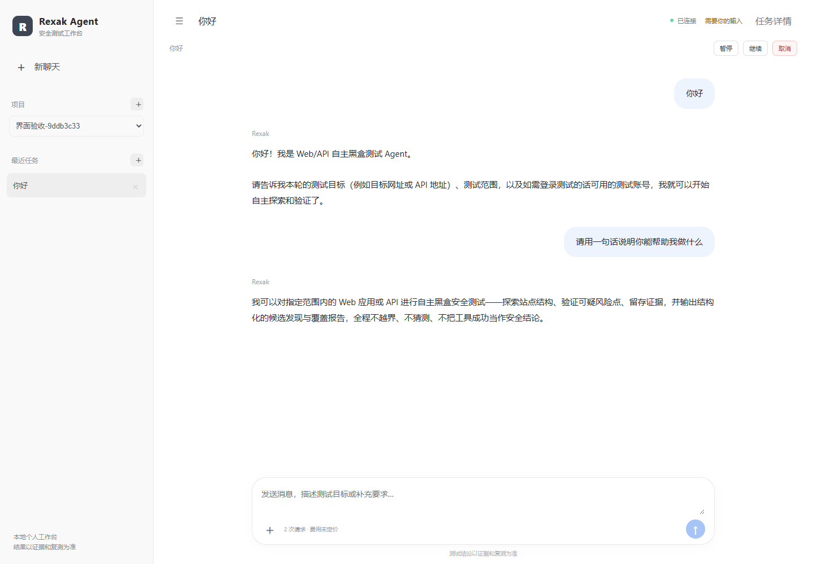

# 对话界面与任务生命周期验收

验收日期：2026-10-11（北京时间）。仓库：`C:\xjs\rexak-agent`。

## 本次实际验证

使用独立的无头 Edge 浏览器，通过页面按钮和输入框操作；测试工作空间 owner 为 `ui-acceptance-20261010-chat`，与日常工作空间分开。真实模型为 `mimo-v2.6-pro`，没有为目标靶机写入答案、任务专用系统提示或模拟模型回复。

| 操作 | 结果 |
| --- | --- |
| 创建项目，范围为空 | 201；空范围拒绝所有远端目标请求 |
| 创建带明确范围的测试任务 | 201；显示在左侧任务列表 |
| 删除尚未执行的任务 | 页面移除；刷新不恢复 |
| 新聊天直接输入“你好” | 建立任务，收到真实模型回复 |
| 追问“请用一句话说明你能帮助我做什么” | 收到第二轮真实模型回复 |
| 刷新当前聊天 | 两轮对话历史保留 |
| 删除当前聊天并刷新 | 列表不再显示；数据库 session=deleted，run=cancelled |
| 提交消息接口返回 503 | 显示错误并保留输入；此项故障由浏览器测试模拟，模型回复未模拟 |
| 浏览器脚本异常 | 最终验收未出现 pageerror |

最后一次验收的任务 ID：`848b59ae-4e95-435f-b117-733168c2febf`；运行 ID：`97978f0a-504d-423f-b773-36e59badff66`。

## 真实模型记录

| 请求 | 首个可见输出 | 模型请求完成 | 输入 / 输出 tokens | 错误 |
| --- | --- | --- | --- | --- |
| 问候 | 3.67 秒 | 6.09 秒 | 8628 / 69 | 无 |
| 追问 | 4.14 秒 | 6.93 秒 | 8697 / 65 | 无 |

时间来自模型调用台账 submitted_at / first_token_at / completed_at，是本次样本，不是性能保证。前端验收等待值分别为 6.41 秒（打开验收页后等待首轮回复）与 9.03 秒（提交追问至回复及等待状态）；两者起点不同，不能直接比较。费用尚未定价，页面显示“费用未定价”，没有把未知费用显示为零。

## 修复依据

- 原项目创建请求未带目标范围，会被非空范围校验拒绝；允许先建项目，空范围保持拒绝所有远端请求。
- 补充任务删除接口与页面入口，隐藏已删除任务，禁止继续投稿；活动运行先进入取消流程，远端退出未确认时不宣称已停止。
- 普通服务只扫描当前工作空间；诊断类数据改为按需加载，避免每次事件同时刷新所有接口。
- 已到 END 的图需要增量输入重新启动；`None` 只用于恢复待执行节点。
- 业务 run_id 不再放入 configurable.run_id；框架会将它提升为 metadata.run_id，并把同 ID 输入视为同次调用重连，导致新消息不执行。业务 ID 改存 metadata.workbench_run_id。
- 普通交流直接回答；收尾判定不再把能力说明中的“结论/总结”误判为已经完成安全测试。真实流式对话只投影 assistant 消息，不混入工具 JSON 或内部反馈。
- 本机与示例数据库连接池配置调整为保留 4 个连接；连接超时只重试握手，不自动重放 SQL 事务或未知模型请求。

## 代码检查与回归

- `uv sync --frozen --all-packages --group dev`、Ruff、Pyright、UTF-8 编码检查、前端类型检查和生产构建通过；`git diff --check` 通过。
- 单元、集成和故障恢复测试：**284 passed，3 skipped**（108.06 秒）。跳过项为 Windows 符号链接权限测试 2 项，以及未向测试进程提供 Key 的供应商能力探针 1 项；上面的两轮真实模型浏览器验收单独执行。
- 最后一轮开始时 Docker Desktop 已停止，数据库夹具失败；恢复 Docker 和数据库后重新完整执行，最终得到上述通过结果。

## 证据边界

前几轮调试实际出现过模型连接失败、数据库重连超时，以及框架续跑配置造成的空转，不能将那些尝试记为通过。以上通过项来自修复后的最后一次完整验收。此次验证证明聊天与任务生命周期可用，没有重新验证 Earth 渗透测试效果，也没有覆盖全部诊断和远端工具功能。

测试服务已经退出；Docker 数据库已恢复运行。部署入口的 `--check-only` 已重新通过数据库、SSH、Executor 检查。重新双击桌面 Rexak Agent 启动更新后的日常工作台；旧页面需要刷新。
