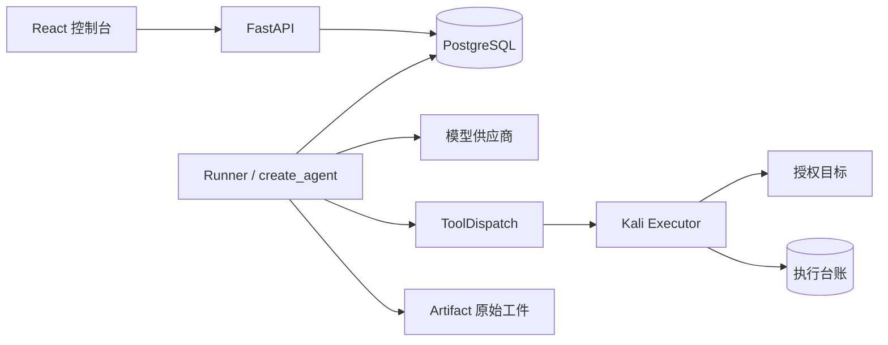

# 当前工程架构

本页以 v1.0 正式入口为准；历史研究报告描述当时实验，不表示当前可选能力。

## 唯一权威与数据流

HTTP 提交用户消息写入指令表；Runner 持有租约后取得指令，以官方 `create_agent` 驱动模型与工具。
模型请求经过响应恢复、ContextBuilder、Decision Memory 历史参考及 ModelObserver，逐次记录实际供应商尝试。
WorkingContext 只读组装领域记录；可选参考只改变发送视图，不覆盖原始 ToolMessage 或 Checkpoint。

ToolDispatch 检查参数、能力、Scope、运行所有权和控制版本。`(run_id, tool_call_id)` 决定稳定 Operation，
相同调用参数冲突被拒绝；Executor 以 Operation 身份复用真实执行结果。未知状态先对账，不能自动重复副作用。
Job 是执行台账的控制端投影。暂停、取消及恢复均保留原身份和控制 fence。

LangGraph Checkpoint 管执行状态和消息；领域表管业务记录；Executor Ledger 管真实执行状态。
Session 信息图包含 Entity/Relation，攻击图包含 AttackState/Attempt，唯一真源为 `session_graphs.document`。
图更新检查来源归属、版本、页确认和租约；模型判断不能写成独立验证的 confirmed 事实。
图 GET 只检查本地会话与 owner 后读取脱敏数据，不产生页确认、事件、回执或 revision 更新。

## 权限与证据

API 只绑定回环地址，Cookie 或访问令牌鉴权；Cookie 写请求要求 CSRF，读请求不要求 CSRF。
模型生成命令只发往独立 Kali；执行岛没有供应商密钥或数据库凭据。Scope 在控制端及执行岛检查。
附件先验证大小、类型、归属和可读状态，再进入受限解析/静态分析；原字节存 CAS，预览与模型输入脱敏。
后台任务、终端与浏览器资源有独立生命周期，模型结束不能冒充资源已经关闭。

## 当前功能边界

保留 Decision Memory 的检索、引用、预算、可见性去重与未知状态；没有第二套 Agent、独立 Planner 或自动业务判成功门禁。
旧 passive 重复执行检测、研究配方工具和 Progress streak 运行路径已删除。
历史配置/Checkpoint 可只读查看，不为恢复旧检测器保留运行入口；旧模式快照映射到 memory。
历史实验目录仅作研究材料，不能作为当前产品能力或效果证明。
