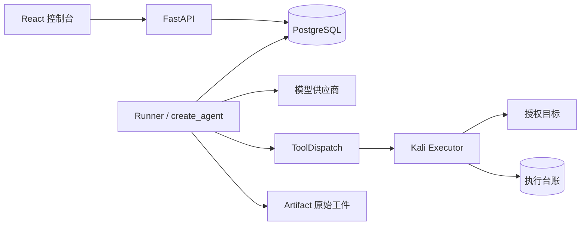

# 当前工程架构

本页包含 v1.0 Standard 和 2026-11-03 Ultra 第一阶段；历史研究报告不表示当前可选能力。

## 唯一权威与数据流

HTTP 提交用户消息写入指令表；Runner 持有租约后取得指令，以官方 `create_agent` 驱动模型与工具。
模型请求经过响应恢复、ContextBuilder、Decision Memory 历史参考及 ModelObserver，逐次记录实际供应商尝试。
WorkingContext 只读组装领域记录；可选参考只改变发送视图，不覆盖原始 ToolMessage 或 Checkpoint。

ToolDispatch 检查参数、能力、Scope、运行所有权和控制版本。`(run_id, tool_call_id)` 决定稳定 Operation，
相同调用参数冲突被拒绝；Executor 以 Operation 身份复用真实执行结果。未知状态先对账，不能自动重复副作用。
Job 是执行台账的控制端投影。暂停、取消及恢复均保留原身份和控制 fence。

LangGraph Checkpoint 管执行状态和消息；领域表管业务记录；Executor Ledger 管真实执行状态。
Session 信息图包含 Entity/Relation，攻击图包含 AttackState/Attempt，唯一真源为 `session_graphs.document`。
图更新检查来源归属、版本、页确认和租约；模型判断不能写成独立验证的 confirmed 事实。
图 GET 只检查本地会话与 owner 后读取脱敏数据，不产生页确认、事件、回执或 revision 更新。

## 权限与证据

API 只绑定回环地址，Cookie 或访问令牌鉴权；Cookie 写请求要求 CSRF，读请求不要求 CSRF。
模型生成命令只发往独立 Kali；执行岛没有供应商密钥或数据库凭据。Scope 在控制端及执行岛检查。
附件先验证大小、类型、归属和可读状态，再进入受限解析/静态分析；原字节存 CAS，预览与模型输入脱敏。
后台任务、终端与浏览器资源有独立生命周期，模型结束不能冒充资源已经关闭。

## 当前功能边界

保留 Decision Memory 的检索、引用、预算、可见性去重与未知状态；Standard 保持单 Agent。
Ultra 按需通过 A2A 委派独立 Pi Agent，支持独立 OpenAI-compatible 模型配置、Session 证据读取及经控制端接入 Kali 的六个 Pi 基础工具；保留确定性 Mock 验收入口。没有第二套 Python 主循环、独立 Planner 或自动业务判成功门禁。工程验收不代表真实靶场效果，范围见 decision 0020–0022。
旧 passive 重复执行检测、研究配方工具和 Progress streak 运行路径已删除。
历史配置/Checkpoint 可只读查看，不为恢复旧检测器保留运行入口；旧模式快照映射到 memory。
历史实验目录仅作研究材料，不能作为当前产品能力或效果证明。

## Ultra 第一阶段

Session 创建时固定 `standard | ultra`，Run 从数据库复制配置快照。Ultra 主 Agent 继续使用原 create_agent，
仅扩展工具注册；Standard 不连接或启动 Node。子任务的本地意图和远端 A2A Task 分开持久化，响应丢失只查询原请求，
不自动重发；Worker 重启保留 unknown，不声称 Pi 无损续跑。父暂停/取消保存清理意图，由独立后台任务核对远端停止。

Worker 固定回环监听并使用服务令牌，独立数据库角色仅访问 ultra_worker schema；不持有 Executor 凭据或主库权限。Goal 第一阶段起使用独立加密模型配置，在后端加载自己的 Provider Key；Key 不进入 A2A 任务或 Executor。
结果经身份和结构验证后存 CAS，只向主 Agent 返回低信任摘要和引用，不创建 confirmed Finding。
详见 [decision 0019](decisions/0019-ultra-a2a-pi-stage1.md) 和 [交付报告](../reports/ultra-stage1/implementation-report.md)。

Goal 第三阶段通过固定控制端回调、原 Operation/fence 与独立 Worker cwd/Home/临时目录接入 read/bash/edit/write/grep/find，保留 list_evidence/read_evidence。目录隔离沿用 trusted 权限，不是操作系统沙箱；详见 [decision 0022](decisions/0022-ultra-pi-executor-tools.md) 和 [实施报告](../reports/ultra-goal-stage3/implementation-report.md)。
