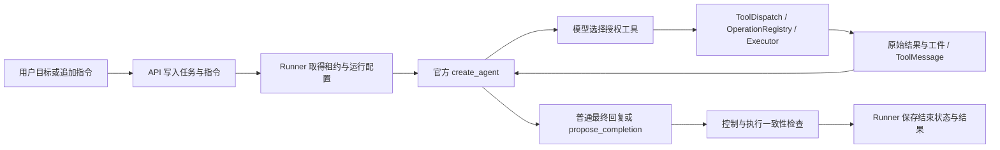

# 第一阶段最小自主闭环：实现与验收

日期：2026-10-22。以本轮工作区实际代码和可复现测试为准。基线为 `79ecfff2891e095328a5dc2cccecc741d17cac18`。本轮修改尚未推送；不包含真实模型或真实靶场效果结论。

## 1. 本轮实现范围

本轮按 [decision 0014](decisions/0014-minimal-autonomous-loop.md) 覆盖旧决策中强制 Assessment、完成证明、领域复查和自动报告的要求。先恢复了隔离 PostgreSQL 测试环境，再取得修改前基线：`688 passed, 3 skipped`。没有清空数据卷，没有增加数据库迁移文件。

| 模块 | 当前行为 |
|---|---|
| `agent/factory.py`、系统提示及方法资料 | 唯一模型—工具决策循环仍为官方 `create_agent`。提示版本 12，方法资料版本 8；不注入复杂领域填表要求。 |
| `tools/planning.py`、`tools/task.py`、`contracts/plan.py` | 删除生产 `assessment_json`、`steps_json` 和完成证明调用；计划改为可选局部 upsert，保留稳定步骤 ID、修订号和不可变修订工件。 |
| `agent/state.py` | 删除独立 WorkAssessment 类型；完成提议改为回答、可选局限与引用。旧通道集中在 `LegacyProtocolState`，新状态不初始化旧协议记录。 |
| `agent/focus.py`、`middleware/working_context.py` | 焦点表示调查方向；普通工具调用不依赖焦点、计划或假设。工作上下文仅呈现少量已有记录和未决作业。 |
| `tools/completion.py`、`middleware/finish_gate.py`、`runtime/stopping.py` | 普通最终回复或轻量显式结束信号均可结束；未完成的可选步骤、Lead 和 Coverage 不再阻止结束。 |
| `middleware/progress.py`、`middleware/stage_report.py`、Runner | 默认不装配两个主动节点，删除 Runner 终态自动 StageReport；旧图恢复时可插入禁用的兼容节点。 |
| `tools/registry.py`、Runner、API/UI | 默认不提供专用 Verification、复杂 `record_weakness` 或 Skills 工具。Skills 调用选择在 API 明确拒绝，界面标为暂停启用。安装和历史记录保留。 |
| `record_observation`、`tools/browser.py` | 停止写 Coverage；观察和资产基本能力保留。浏览器越界仍拒绝、不下载越界正文，保留失败操作及执行快照。 |
| `api/routes.py`、前端计划视图及生成类型 | 计划 API 移除 Assessment 与完成协议的活动字段，旧附加数据放在只读 `legacy_metadata` 中；Coverage 明确标为历史记录。 |
| Runner、对话读取 API | 显式结束回答从已提交 checkpoint 归档为不可变工件，保留可重建的读取指针，支持对话分页和完整正文读取；不伪造一次模型调用。事件只携带有界文本与工件引用。 |

没有删除历史表、原始工件或执行台账。保留 CommandGuard、ToolDispatch、Executor、OperationRegistry、租约、控制版本、未知副作用保护、模型观测及现有摘要基础设施。

## 2. 最小执行链路



CommandGuard 在模型边界处理暂停、取消、追加指令并固定控制版本。ToolDispatch 在派发前核对所有权、控制版本、能力及参数；真实操作身份与执行台账继续负责去重和 unknown 保护。模型返回的工具结果进入官方 ToolMessage，再进入下一轮模型请求。

计划、Focus、Lead、Observation 和候选 Finding 都是按需使用的工作记录。记录成功不是执行工具的前提，也不意味着漏洞成立。未采用新 Planner、Reflection Graph 或第二套 Agent 主循环。

## 3. 活动状态与工具 Schema

状态版本为 **7**。活动字段保留：官方消息；会话/运行身份；目标和用户约束；控制版本及交付回执；工作摘要；可选计划、修订与焦点；未决作业；上下文版本与 manifest；轻量结束信号；分段轮次及迁移标记。

旧 Assessment、Skills 引用、覆盖修订、复查游标、弱点消费进度、无进展和报告字段仅保留兼容通道。它们仍可能出现在旧 checkpoint 中，不能据此声称已从存储物理删除。旧计划的完成证明原文仍可读取，但不再注入生产模型上下文或决定步骤完成。

模型可见的两个主要入口：

```text
update_plan(
  expected_plan_revision: int,          # 唯一必填参数
  steps?: [{step_id, description?, status?, rationale?, lead_id?}],
  focus?: string, rationale?: string
)

propose_completion(
  goal_answer: string,                  # 唯一必填参数
  reason?: goal_answered | exploration_converged,
  limitations?: string, evidence_refs?: [artifact_id]
)
```

`steps` 只提交需要新增或修改的条目；省略的步骤和字段保持原样。新步骤需要 description，已有步骤仅更新状态无需重复正文。支持 pending、in_progress、done、dropped、blocked。计划当前最多保留 20 步，单次最多更新 20 步；可修改或复用已有步骤。焦点可独立于计划存在，空字符串清除。

计划和焦点共享修订号；同批多个计划写者全部拒绝，过期修订和过期控制边界拒绝写入。修订工件只有被 checkpoint 引用后才成为有效投影。`done` 不写 Finding 的 confirmed 状态。

`record_lead` 只保留假设、可选下一动作、状态/说明、真实证据引用及简单关联；不要求条件关系或 actionability 证明。`record_observation` 不再提供 coverage_status。普通工具返回后不要求再登记这些记录。停用工具或旧参数在派发层明确反馈错误，不能静默忽略后执行。

## 4. 结束与恢复边界

普通无工具最终回复是官方循环的自然结束信号；显式 `propose_completion` 同样走 FinishGate。无需再调用模型填复杂完成表。仍检查：未消费指令、无效/跨会话/不可用工件引用、未决或 unknown 操作/作业、明确等待集合。已确认历史发现的验证记录与证据完整性检查保留；候选不会因计划完成、工具成功或任务结束而自动确认。

显式回答保存在 checkpoint，Runner 根据该提交结果生成不可变正文工件。运行配置只存归档读取指针，不持有第二份可写结果正文。相同运行、相同消息的投影使用稳定 ID，重查不重复生成展示事件；不会把此前运行的最终消息投影到新运行。

v6→v7 适配保留原计划、历史 Assessment、消息和待执行节点；老版本按现有适配链顺序处理。旧 Progress/StageReport 节点可以用禁用实例恢复，不运行主动协议。含未提交并行结果或不能保持原边界的迁移明确拒绝，要求核对台账；不猜测或重放不确定副作用。

新增用户指令会清除此前完成信号，继续沿同一 thread 运行。暂停、恢复、取消、租约和控制版本仍走原控制机制。

## 5. 可复现验证

最终验收结果在本节末记录。主要命令：

```powershell
uv sync --frozen --all-packages --group dev
uv run ruff check .
uv run pyright
uv run python scripts/check_encoding.py
uv run pytest tests/unit tests/integration -q
uv run pytest tests/recovery -q
uv run python scripts/export_openapi.py web/openapi.json
cd web
pnpm install --frozen-lockfile
pnpm generate:api
pnpm build
```

新增 `test_minimal_autonomous_loop.py` 使用真实任务 API、Runner、官方图、PostgreSQL Saver/Store、模型观测和工件存储，只替换供应商模型与执行端为受控替身。工具实际读取本地文件，模型读取第一条 ToolMessage 的值再决定第二次调用。分别验证：无计划自然结束、无计划显式结束、保留未完成可选计划仍能显式结束；跨分段持续运行、关闭 runtime 后恢复 checkpoint、原始工件哈希、历史与最终正文读取、重复投影不重复展示。

其他新增/调整验证包括：局部计划更新与并发修订；候选保持 candidate；可选 Lead 不构成结束义务；旧复杂证明仅作为历史校验数据；v6 迁移和禁用节点恢复；追加指令清除完成信号；Skills 暂停的 API/Schema 表现；浏览器两种范围拒绝场景保留失败操作且不下载正文、不写 Coverage。授权、控制版本、原始证据真实性和未知副作用保护测试继续执行。

测试数据库由 fixture 创建独立随机名称，测试完成后只清理该数据库，不使用用户业务数据库作为测试库。旧强制证明/复查行为的测试已改成新行为断言；来源真实性、并发、操作身份和恢复检查继续保留。

验收汇总：

| 检查 | 结果 |
|---|---|
| 后端 unit + integration 全量 | **681 passed, 3 skipped**，339.93 秒；24 条警告为测试替身 SimpleNamespace 的 Pydantic 序列化提示。 |
| Recovery 专项 | **42 passed**；最终版本再次组合运行恢复、最小闭环、范围拒绝与健康版本检查，**49 passed**，136.72 秒。组合中的 7 项与全量集重叠，不重复累计。 |
| Ruff / Pyright | 通过；Pyright 为 **0 errors, 0 warnings**。 |
| UTF-8 编码 | **526 个文件通过**，无 BOM、替换字符或检测到的乱码片段。 |
| 冻结依赖 | Python 91 个包核对通过；前端 frozen lockfile 安装通过。 |
| OpenAPI / 前端 | 从当前 API 导出并生成类型；TypeScript 与 Vite 构建通过，177 个模块。 |
| Git 工作区差异 | `git diff --check` 通过；修改保留工作区供评估，未执行 GitHub 推送。 |

3 项跳过分别为 Windows 下需要额外权限的两个符号链接测试，以及真实 Xiaomi API Key 探针。真实模型测试按用户要求没有运行。没有将历史 688 项与当前 681 项直接当作功能增减计数：旧强制协议测试已替换为新行为与兼容测试。

## 6. 本机与 Kali 检查

桌面 `Rexak Agent.lnk` 仍指向本仓库 `start-workbench.cmd`。本轮通过原启动链的 API-only 冒烟模式检查数据库、SSH、Executor、API 和控制台；该模式不运行真实模型任务。受控测试验证了 Runner 的实际装配链。

验收前业务库保有 5 个会话、5 个运行、382 个工件、156 个操作，其中 2 个运行暂停。Kali 已安装的 23 个 Python 文件哈希与本机一致，身份一致，协议版本 1，可信执行能力预检可用，活动作业为 0。本轮 Executor 源码没有变化，因此保留现有进程，不执行无必要的更新或重启。

原入口启动冒烟通过，控制台 HTTP 200，运行进程报告提示版本 **12**、代码指纹 `loaded-minimal-loop:09ca90ff7aad07ecd99ed886ff3439185521f1d9`，与新进程直接加载的指纹一致。冒烟完成后只停止本次创建的 API 进程，PostgreSQL 和既有 Kali 进程保留；没有留下运行中的测试任务。API 与 CLI 的指纹范围标签统一为最小循环入口，不能解释为整个进程全部文件的加载证明。

启动后复核：上述 5/5/382/156 个记录数量均未改变，2 个暂停运行的状态、代次及控制版本均未改变，`.env` 文件哈希未改变。没有清空数据卷、删除凭据或用户数据，没有自动恢复暂停任务，没有扫描外部目标，也没有调用真实模型 API。

## 7. 行为对比与剩余工作

| 场景 | 本轮之前 | 本轮之后 |
|---|---|---|
| 初始调用工具 | 协议提示容易引导先维护计划和领域记录 | 可直接调用已授权工具；脚本模型已验证连续调用 |
| 普通反思、换焦点 | 关键变更绑定 Assessment | 在正常模型循环中分析；focus 是可选文本 |
| 修改单步 | 复杂整体计划、完成规格/证明 | 提交一个 step_id 及变化字段 |
| 工作步骤完成 | 需要专门完成证明 | 可直接 done；不提升漏洞验证等级 |
| 结束 | 领域库存、可选步骤、Coverage 可能强制继续 | 模型给最终结果；程序只保留控制、执行和证据完整性约束 |
| 未验证方向 | 容易变成必须处理的复查义务 | 可保留并说明局限，候选仍为候选 |
| 报告、无进展提醒 | 主循环自动维护 | 默认停用，基本执行历史保留 |

本轮保留的技术债：旧 `contracts/planning.py`、`planning_validation.py` 及 HTTP/适用性校验辅助模块，旧领域关系/复查库存、旧工作上下文构建函数、报告快照和专用 Verification 服务仍在代码中供历史读取、显式旧接口或兼容测试使用；未物理删除数据库表和旧字段。新旧字段共存期间仍需维护迁移适配。历史 confirmed 记录的完整性校验仍可能阻止不可信的既有确认结果被当作正常结论。

本轮没有设计信息图、向量检索、RAG、新的历史记忆体系或新的 Verification。ContextBuilder、GuardedSummarization 和既有历史归档保留基本能力；少量事实目录有展示上限，完整内容通过历史/工件工具读取，不构成完整信息检索保证。

受控模型测试只能证明工程闭环和恢复机制，不能证明真实模型会持续高效探索或在 Tomcat 等目标上取得有效结果。真实 API Key、真实模型自主性、真实靶场效果以及长期运行质量留给用户单独评估。本阶段完成后停止进一步架构扩展。
